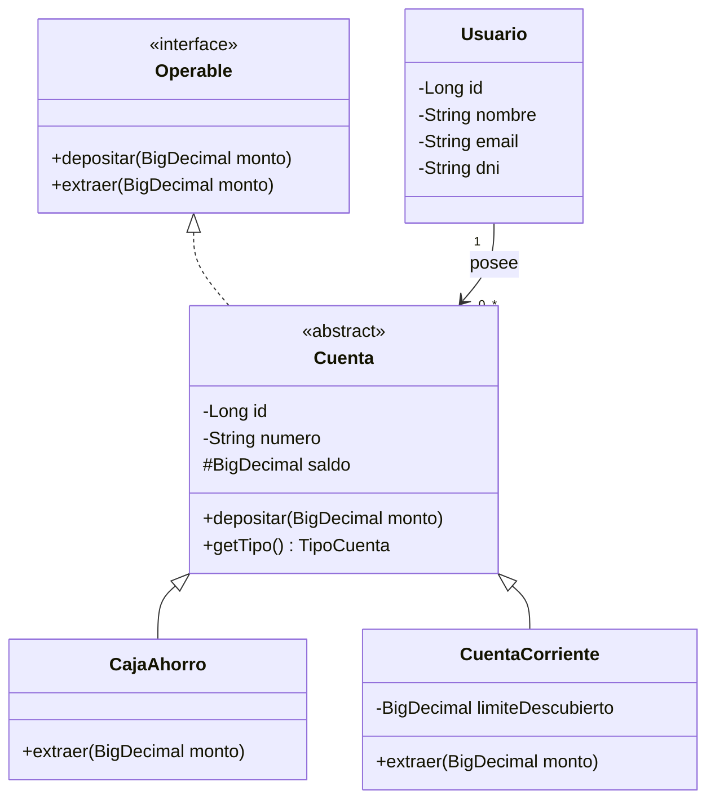
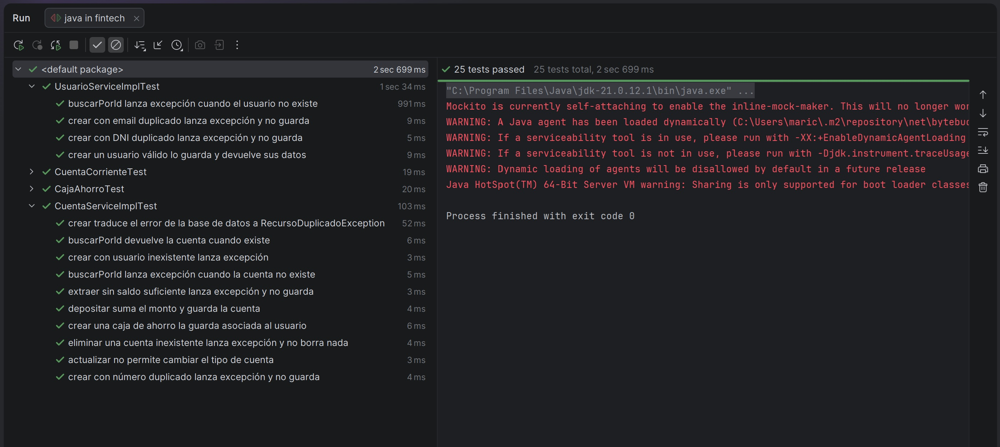

# API Fintech

API REST desarrollada en **Java 21 + Spring Boot 4** que simula un sistema bancario básico de gestión de **usuarios y cuentas** (caja de ahorro y cuenta corriente), con persistencia en **MySQL**, manejo centralizado de errores, documentación **Swagger/OpenAPI** y **tests unitarios**.

Actividad práctica — Clase 14 — Diplomatura en Desarrollo de Software FinTech: IA y Microservicios (UTN BA).

---

## Tecnologías

- Java 21
- Spring Boot 4.1 (Spring Web MVC, Spring Data JPA, Bean Validation)
- MySQL 8
- springdoc-openapi (Swagger UI)
- JUnit 5 + Mockito
- Maven (wrapper incluido)

---

## Modelo de dominio



- **Interfaz:** `Operable` define las operaciones de toda cuenta.
- **Clase abstracta:** `Cuenta` implementa la lógica común (depósito y validación de montos) y deja `extraer` a cada subclase.
- **Herencia y polimorfismo:** `CajaAhorro` no permite saldo negativo; `CuentaCorriente` permite operar en descubierto hasta su límite.
- **Relación:** un `Usuario` posee muchas `Cuenta` (1 a N).

---

## Arquitectura

Organización por capas:

```
src/main/java/com/utn/fintech/
├── controller   → Endpoints REST (sin lógica de negocio)
├── service      → Lógica de negocio (interfaz + implementación)
├── repository   → Acceso a datos con Spring Data JPA
├── model        → Entidades de dominio
├── dto          → Objetos de entrada y salida de la API
├── mapper       → Conversión entidad ↔ DTO
├── exception    → Excepciones custom y handler global
└── config       → Configuración de OpenAPI
```

---

## Requisitos previos

- **JDK 21**
- **MySQL 8** corriendo en `localhost:3306`

---

## Cómo ejecutar 

### 1. Clonar el repositorio

```bash
git clone https://github.com/MaricelPS/api-fintech.git
cd api-fintech
```

### 2. Configurar la contraseña de MySQL

La contraseña se lee de la variable de entorno `DB_PASSWORD`, para no guardarla en el código. La base `fintech` se crea automáticamente al iniciar.

**Windows (PowerShell):**

```powershell
$env:DB_PASSWORD="tu_contraseña"
```

**Linux:**

```bash
export DB_PASSWORD="tu_contraseña"
```

Si tu usuario de MySQL no es `root`, modificá `spring.datasource.username` en `src/main/resources/application.properties`.

### 3. Levantar la aplicación

**Windows:**

```powershell
.\mvnw.cmd spring-boot:run
```

**Linux:**

```bash
./mvnw spring-boot:run
```

La API queda disponible en `http://localhost:8080`.

---

## Documentación (Swagger)

Con la aplicación corriendo:

- **Swagger UI:** http://localhost:8080/swagger-ui.html
- **Especificación OpenAPI (JSON):** http://localhost:8080/v3/api-docs

---

## Endpoints

### Usuarios

| Método | Ruta | Descripción |
|---|---|---|
| GET | `/usuarios` | Listar usuarios con sus cuentas |
| GET | `/usuarios/{id}` | Obtener un usuario |
| POST | `/usuarios` | Crear un usuario |

### Cuentas

| Método | Ruta | Descripción |
|---|---|---|
| GET | `/cuentas` | Listar cuentas |
| GET | `/cuentas/{id}` | Obtener una cuenta |
| POST | `/cuentas` | Crear una cuenta |
| PUT | `/cuentas/{id}` | Actualizar una cuenta |
| DELETE | `/cuentas/{id}` | Eliminar una cuenta |
| POST | `/cuentas/{id}/deposito` | Depositar dinero |
| POST | `/cuentas/{id}/extraccion` | Extraer dinero |

### Ejemplo: crear una cuenta corriente

```http
POST /cuentas
Content-Type: application/json

{
  "numero": "CC-0001",
  "tipo": "CUENTA_CORRIENTE",
  "usuarioId": 1,
  "limiteDescubierto": 5000
}
```

---

## Manejo de errores

Todos los errores se manejan de forma centralizada en `GlobalExceptionHandler` (`@RestControllerAdvice`) y devuelven un formato uniforme:

```json
{
  "status": 404,
  "mensaje": "No existe la cuenta con id 99",
  "detalles": [],
  "timestamp": "2026-10-20T10:30:00"
}
```

| Código | Situación |
|---|---|
| 400 | Datos inválidos, body mal formado o monto no positivo |
| 404 | Cuenta, usuario o ruta inexistente |
| 409 | Número de cuenta, email o DNI duplicado |
| 422 | Saldo insuficiente para la extracción |
| 500 | Error inesperado (se registra en el log sin exponer detalles al cliente) |

---

## Colección de Postman

En la carpeta `postman/` está la colección `API-Fintech.postman_collection.json`.

1. En Postman: **Import** → seleccionar el archivo.
2. La colección incluye la variable `baseURL` (`http://localhost:8080`).
3. Ejecutar los requests **en orden y sobre una base vacía**: primero se crea el usuario (id 1) y después sus cuentas. Al final están los casos de error.

Para reiniciar la base y volver a ejecutar la colección desde cero:

```sql
DROP DATABASE fintech;
```

Al volver a levantar la aplicación, la base y las tablas se recrean automáticamente.
---

## Tests

Tests unitarios con **JUnit 5** y **Mockito**, sin dependencias externas (no requieren MySQL):

- **Dominio** (`CajaAhorroTest`, `CuentaCorrienteTest`): reglas de depósito, extracción, saldo insuficiente y descubierto.
- **Servicios** (`CuentaServiceImplTest`, `UsuarioServiceImplTest`): orquestación con repositorios simulados, validación de duplicados, recursos inexistentes y traducción de errores de base de datos.

```powershell
.\mvnw.cmd test
```

---

## Decisiones técnicas

- **`BigDecimal` para montos:** evita los errores de redondeo de `double` en operaciones con dinero.
- **Herencia `SINGLE_TABLE`:** todas las cuentas se guardan en una tabla con una columna `tipo` que las distingue. Es la estrategia más simple y eficiente para jerarquías con pocos atributos propios.
- **DTOs separados de las entidades:** evitan exponer el modelo interno y la recursión infinita en el JSON por la relación bidireccional `Usuario` ↔ `Cuenta`.
- **Encapsulamiento del saldo:** no existe `setSaldo`; el saldo solo cambia mediante `depositar` y `extraer`, que aplican las reglas de negocio.
- **Reglas de negocio en el dominio:** la validación de saldo vive en cada tipo de cuenta, no en el servicio. El servicio solo orquesta.
- **Doble control de duplicados:** primero se verifica con el repositorio (mensaje claro); además, un `try/catch` traduce la violación de restricción `unique` de la base a una excepción de dominio, cubriendo requests concurrentes.
- **PUT restringido:** no se permite cambiar el tipo de cuenta ni su titular.
- **Credenciales por variable de entorno:** la contraseña de la base no se versiona en el repositorio.